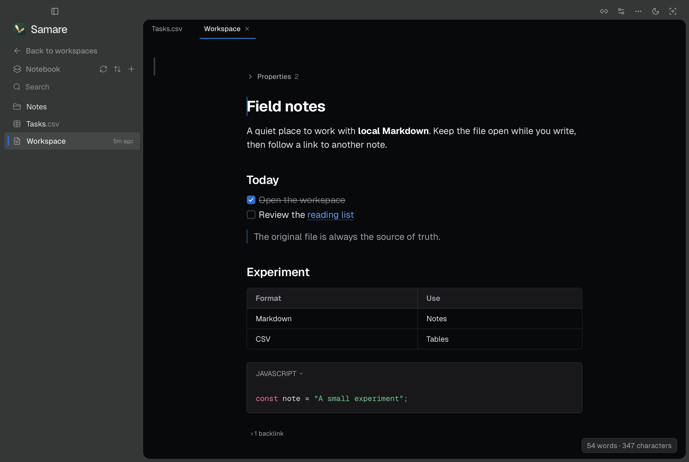

# Samare

Samare is a local Markdown editor for macOS. Open a folder on your Mac, write in the desktop app, then give an agent a link to the same file. Edits from the browser and the desktop go back to the file you opened. Samare also opens CSV, TSV, JSON and JSON Lines as editable tables, fields or records.



## Install on macOS

In **Apple menu → About This Mac**, look for the chip or processor. Choose **arm64.dmg** for an Apple M-series chip or **x86_64.dmg** for an Intel processor from [GitHub Releases](https://github.com/Digidai/samare/releases/latest). Open the disk image and drag Samare into Applications. See the release notes for the signing and Apple notarization status of each download. If Gatekeeper blocks the download, you can build Samare from source using the instructions below.

Each release build checks a separate signed update feed for its processor. The Apple Silicon release lists its checksums in `SHA256SUMS` and the Intel release in `SHA256SUMS-intel`. Builds you make yourself only check a feed when you configure one.

## Build and open

Use a Mac with the Xcode Command Line Tools installed. The build downloads checksum-pinned copies of Sparkle and a standalone Python runtime for your Mac’s architecture. The app targets macOS 12 or later. Building on Apple Silicon produces an arm64 application, and building on an Intel Mac produces an x86_64 application.

```sh
git clone https://github.com/Digidai/samare.git
cd samare
./build.sh
open build/Samare.app
```

The browser assets ship in the source tree, so a normal app build needs neither npm nor an installed copy of another editor. Local builds use ad-hoc code signing. To make a drag-to-Applications disk image, run `Updates/package-dmg.sh`. The disk image appears in `build/Samare.dmg`.

To build the Intel app on an Apple Silicon Mac with Rosetta installed, run `SAMARE_BUILD_ARCH=x86_64 ./build.sh build/intel/Samare.app`. The Intel release test mounts the disk image, checks every executable, launches the app and reads text from a rendered Markdown document.

## Try it with your own files

1. Choose **Add workspace** and select a folder. You can also open the included `Samples` folder.
2. Open a Markdown file. Use **⌘K** for commands, **⌘P** to find a file and **⌘F** to search the current document.
3. To work with an agent, open **Settings → Use in Agent**. Samare can install its local command and client instructions for Codex, Claude Code and Cursor. You can copy the instructions for an already running chat.
4. With the file open, press **⌘L** to copy its link. From a terminal, the equivalent command is:

```sh
"$HOME/.local/bin/samare" url "$PWD/Samples/Workspace.md"
```

The bridge listens on loopback. A browser on the same Mac can edit the registered document through the link. Treat the link as permission to read and write that document. Samare keeps its registration database under `~/Library/Application Support/Samare/Bridge/`. To inspect the service, run `"$HOME/.local/bin/samare" doctor`. Background operation after the app closes is a separate setting.

Markdown supports progressive rendering for long documents, wiki links, Mermaid, math, source editing, external-edit conflict review, HTML/PDF export and Finder Quick Look. On the Mac where you use Samare, Finder may offer more than one Markdown preview extension.

## Develop and test

The native host and Quick Look extension are in `Native/`. The editor and workspace are in `Resources/`. The Python bridge, its CLI and the browser entry point are in `Bridge/`. Update packaging and signature verification live in `Updates/`.

```sh
npm ci
npm run vendor
Native/test.sh
```

The tests below use real browser processes and temporary documents. Install Google Chrome for the bridge tests. For the editor tests, use the Playwright-managed Chromium browser or set `CHROME_PATH` to a local Chrome executable.

```sh
npx playwright install chromium
npm run test:editor
PLAYWRIGHT_MODULE=playwright npm run test:bridge
```

The interface icons can be regenerated independently with `npm ci --prefix tools/icons` and `npm run generate --prefix tools/icons`. The application icon and installer artwork also have editable sources in this repository.

## Publish updates for your own build

An ordinary source build opens and edits files without release credentials. To enable signed automatic updates, generate a new Ed25519 key outside the repository and set `SAMARE_UPDATE_PUBLIC_KEY` and `SAMARE_UPDATE_FEED_URL` when building. Supply the public key printed by the following command and an HTTPS appcast URL you control.

```sh
swift Updates/new-key.swift /path/outside/the/repository/ed25519
# After setting the two variables in your shell:
./build.sh
python3 Updates/package-release.py --key /path/outside/the/repository/ed25519 --channel /path/to/release-output
```

Host the generated appcast and archive together. If your feed redirects or the archive lives elsewhere, pass `--archive-base-url` with the public HTTPS directory containing the archive. Keep the private key with the publisher. Apple Developer ID signing and notarization are separate from Sparkle’s update signatures.

For releases with separate processor builds, give the Intel binary a feed URL ending in `/appcast-intel.xml` and Apple Silicon a URL ending in `/appcast.xml`. Package each build into its own channel directory. Publish the two feeds and their corresponding archives with each release.

### Apple notarization for maintainers

Inspect the built app with `Updates/notarize-release.py --check --app build/Samare.app`. Submission requires a **Developer ID Application** certificate with its private key in the signing keychain, and an authenticated `notarytool` keychain profile. Run the following for each architecture, using a new output directory each time.

```sh
Updates/notarize-release.py --submit --app build/Samare.app --profile YOUR_PROFILE --output build/notarized-arm64
```

The tool signs the nested components, submits the app and disk image to Apple, staples the accepted tickets and checks Gatekeeper. Keep the Apple submission receipts. To distribute a notarized version through Sparkle, pass the stapled `Samare.app` from the output directory to `Updates/package-release.py --app`.

## 中文简介

在 Samare 中打开 Mac 上的文件夹，选中一份 Markdown，然后按 ⌘L。把复制的链接交给同一台 Mac 上的 Agent，它在浏览器中所作的修改会写回这份文件。CSV、TSV、JSON 和 JSONL 也可以在这个工作区里查看和编辑。

首次使用 Agent 时，在 **Settings → Use in Agent** 启用本地命令和需要的客户端。仓库提供桌面端、浏览器编辑器、Bridge、Quick Look 扩展、构建脚本和签名更新工具的源码。

### 在发布用的 Mac 上配置 Apple 公证

1. 登录 Apple Developer 账户，在 **Membership details（会员资格详情）** 确认 Apple Developer Program 会员有效，记下十位 **Team ID**。本地 Developer ID 证书由 **Account Holder（账户持有人）** 创建。[Apple 证书说明](https://developer.apple.com/help/account/certificates/create-developer-id-certificates/) · [查找 Team ID](https://developer.apple.com/help/glossary/team-id/)

2. 打开 **Xcode → Settings → Apple Accounts**，登录并选中上一步的团队。进入 **Manage Certificates → ＋ → Developer ID Application**。如果团队已有证书及私钥的加密 `.p12` 备份，可在这台 Mac 的「钥匙串访问」中导入到「登录」钥匙串。若由同事担任 Account Holder，可在本机「钥匙串访问 → 证书助理 → 从证书颁发机构请求证书」创建 CSR，让对方签发 **Developer ID Application** 证书，再在本机双击返回的 `.cer`。私钥留在生成 CSR 的 Mac 上。[Apple 的 CSR 操作说明](https://developer.apple.com/help/account/certificates/create-a-certificate-signing-request/)

3. 在终端运行下面的命令。输出中应出现一条有效的 `Developer ID Application: 名称 (TEAMID)`。在「钥匙串访问 → 登录 → 我的证书」展开该条目，也应能看到配对的私钥。

   ```sh
   security find-identity -v -p codesigning
   ```

4. 在 Apple 账户的 **登录与安全 → App 专用密码** 创建一个密码，可命名为 `Samare Notary`。账户需启用双重认证。在终端运行下面的命令，把引号中的两个示例值换成自己的邮箱及 Team ID。等终端提示时再粘贴 App 专用密码并回车，输入不会回显。密码只交给本机钥匙串。[Apple 的 App 专用密码说明](https://support.apple.com/en-us/102654) · [notarytool 的交互式验证](https://developer.apple.com/documentation/technotes/tn3147-migrating-to-the-latest-notarization-tool)

   ```sh
   xcrun notarytool store-credentials samare-notary \
     --apple-id '你的 Apple 账户邮箱' \
     --team-id '你的十位 Team ID'
   ```

5. 验证 Apple 服务能读取这组凭据。看到下面的中文成功提示即完成账户配置。与协作者交接时只需提供 profile 名称 `samare-notary`；私钥、密码、`.p12` 和 `.p8` 都留在受控环境。

   ```sh
   xcrun notarytool history --keychain-profile samare-notary --output-format json >/dev/null \
     && echo '公证账户验证成功'
   ```

6. 发布时先核对候选应用的版本、处理器架构和更新地址，然后按上文的 **Apple notarization for maintainers** 分别处理 Apple Silicon 和 Intel。只有当 Apple 返回 `Accepted`、应用与 DMG 的 `stapler validate` 和 Gatekeeper 检查均通过后，才将该下载件标记为已公证。[Apple 公证流程](https://developer.apple.com/documentation/security/notarizing-macos-software-before-distribution)

## License

Samare is an independent project inspired by [Dawn](https://getdawn.co/) and its workflow for local documents. Samare’s original code and artwork use the [MIT License](LICENSE). Bundled open-source libraries and fonts retain their own licenses and copyright notices. See [third-party notices](THIRD-PARTY-NOTICES.txt).
